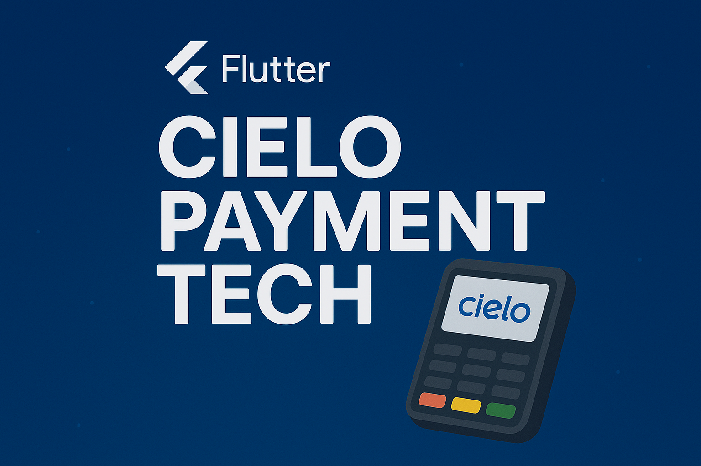

# cielo_payment_tech

<div align="center">
  
</div>

---

## 🚨 Aviso

> **Este plugin é _não oficial_** e foi desenvolvido de forma independente para facilitar a integração de pagamentos via SDK da Cielo em dispositivos Android Smart POS.

Plugin Flutter para facilitar a integração com o SDK de pagamentos da Cielo através do LIO.

**Package:** `br.com.jylabtech.cielo_payment_tech`

## Descrição

Este plugin simplifica a integração com o SDK de pagamentos da Cielo, permitindo que desenvolvedores trabalhem apenas com código Flutter, enquanto o plugin gerencia toda a comunicação nativa com o LIO através de deep linking.

**Características principais:**

- ✅ Integração simplificada com LIO via deep linking
- ✅ Sistema de licenciamento integrado e seguro
- ✅ Validação de licença automática no nativo
- ✅ Callbacks assíncronos para sucesso e erro
- ✅ Suporte a pagamentos de crédito e débito
- ✅ Interface simples e intuitiva

## Instalação

Adicione a dependência no seu `pubspec.yaml`:

```yaml
dependencies:
  cielo_payment_tech: ^2.1.0
```

## Configuração Android

### 1. Enviar as chaves de licença em tempo de execução

As chaves não são mais configuradas no `local.properties`. Elas devem ser fornecidas pelo app ao chamar `CieloPaymentTech.I.initPayment` (por exemplo, lidas de um backend seguro). Veja a seção **Licença do plugin** para saber onde adquirir a chave e qual valor usar em `licenceInternalKey`.

### 2. Configurar Intent Filter

Adicione os intent filters no `AndroidManifest.xml` do seu **app** (na `MainActivity`) para receber os callbacks do LIO. O host `payment` recebe o retorno dos pagamentos e o host `response` recebe o retorno de cancelamentos e impressões:

```xml
<activity
    android:name=".MainActivity"
    android:launchMode="singleTop"
    android:exported="true"
    ...>

    <!-- Intent filter para deep linking -->
    <intent-filter>
        <action android:name="android.intent.action.VIEW" />
        <category android:name="android.intent.category.DEFAULT" />
        <category android:name="android.intent.category.BROWSABLE" />
        <data
            android:host="payment"
            android:scheme="order" />
    </intent-filter>

    <!-- Retorno de cancelamento e impressão -->
    <intent-filter>
        <action android:name="android.intent.action.VIEW" />
        <category android:name="android.intent.category.DEFAULT" />
        <category android:name="android.intent.category.BROWSABLE" />
        <data
            android:host="response"
            android:scheme="order" />
    </intent-filter>
</activity>
```

**Nota:**

- O `launchMode="singleTop"` é importante para garantir que o deep link seja processado corretamente
- O `android:exported="true"` é necessário para que o deep link funcione
- O plugin processa automaticamente os deep links no nativo, então não é necessário configurar nada adicional no código Dart

## Uso

### 1. Implementar o Handler

Crie uma classe que implementa a interface `ICieloHandler` para receber os callbacks do plugin:

```dart
import 'package:cielo_payment_tech/cielo_payment_tech.dart';

class MyPaymentHandler implements ICieloHandler {
  @override
  Future<void> onTransactionSuccess(Map<String, dynamic> response) async {
    // response contém os dados completos do pagamento aprovado
    // Exemplo: id, status, payments, items, etc.
    print('Pagamento aprovado: $response');

    // Você pode acessar os campos específicos:
    // final orderId = response['id'];
    // final status = response['status'];
    // final payments = response['payments'];

    // Atualizar UI, salvar no banco de dados, etc.
  }

  @override
  Future<void> onCancelSuccess(Map<String, dynamic> response) async {
    // Retorno do LIO após um cancelamento concluído
    print('Cancelamento concluído: $response');
  }

  @override
  Future<void> onPrintSuccess(Map<String, dynamic> response) async {
    // Retorno do LIO após uma impressão concluída
    print('Impressão concluída: $response');
  }

  @override
  Future<void> onError(String message) async {
    // message contém a descrição do erro
    print('Erro no pagamento: $message');

    // Mostrar mensagem de erro ao usuário, fazer log, etc.
  }

  @override
  Future<void> onMessage(String message) async {
    // message contém mensagens informativas durante o processo
    // Exemplo: "Licença recebida. Validando...", "Licença ativada", "Pagamento iniciado...", etc.
    print('Mensagem: $message');

    // Atualizar status na UI, mostrar loading, etc.
  }
}
```

### 2. Inicializar o Plugin

```dart
import 'package:cielo_payment_tech/cielo_payment_tech.dart';

// Criar o handler
final handler = MyPaymentHandler();

// Inicializar o plugin informando as chaves de licença
final payment = CieloPaymentTech.I.initPayment(
  handler: handler,
  licenceKey: 'SUA_LICENCE_KEY', // chave obtida em https://portal.jylabtech.com.br
  // licenceInternalKey é opcional (padrão: CieloPaymentTech.licenceCheck)
  urlCallback: "order://payment", // Opcional, padrão é "order://payment"
);

// Agora você pode usar o objeto payment para realizar pagamentos
```

**Nota:**

- As chaves precisam ser fornecidas em tempo de execução ao chamar `initPayment`. Recomenda-se obtê-las de uma API segura.
- A inicialização deve ser feita uma vez, geralmente no `initState()` ou `main()`
- O plugin valida a licença automaticamente antes de cada pagamento, cancelamento e impressão. Sem licença válida a operação não é executada e o erro `LICENCE_ERROR` chega em `onError`

### 3. Realizar Pagamento

#### Pagamento de Crédito à Vista

```dart
try {
  final success = await payment.creditPayment(
    amount: 10000, // Valor em centavos (R$ 100,00)
    accessToken: "seu_access_token",
    clientId: "seu_client_id",
    merchantCode: "seu_merchant_code", // Opcional
    email: "email@exemplo.com", // Opcional
    installments: 0, // Para crédito à vista, use 0
    items: [
      PaymentItem(
        name: "Produto",
        quantity: 1,
        sku: "SKU123",
        unitOfMeasure: "UN",
        unitPrice: 10000,
      ),
    ],
  );

  if (success) {
    // O pagamento foi iniciado
    // O resultado será retornado via onTransactionSuccess ou onError no handler
  }
} catch (e) {
  // Tratar erros de licença ou outros erros
  print('Erro: $e');
}
```

#### Pagamento de Débito à Vista

```dart
try {
  final success = await payment.debitPayment(
    amount: 10000, // Valor em centavos (R$ 100,00)
    accessToken: "seu_access_token",
    clientId: "seu_client_id",
    merchantCode: "seu_merchant_code", // Opcional
    email: "email@exemplo.com", // Opcional
    items: [
      PaymentItem(
        name: "Produto",
        quantity: 1,
        sku: "SKU123",
        unitOfMeasure: "UN",
        unitPrice: 10000,
      ),
    ],
  );

  if (success) {
    // O pagamento foi iniciado
    // O resultado será retornado via onTransactionSuccess ou onError no handler
  }
} catch (e) {
  // Tratar erros de licença ou outros erros
  print('Erro: $e');
}
```

#### Pagamento Customizado

Para ter mais controle sobre o pagamento, você pode criar um `PaymentRequest` customizado com qualquer tipo de pagamento suportado:

```dart
import 'package:cielo_payment_tech/cielo_payment_tech.dart';

// Exemplo: Pagamento PIX
final paymentRequestPix = PaymentRequest(
  accessToken: "seu_access_token",
  clientId: "seu_client_id",
  email: "email@exemplo.com",
  installments: 0,
  items: [
    PaymentItem(
      name: "Produto",
      quantity: 1,
      sku: "SKU123",
      unitOfMeasure: "UN",
      unitPrice: 10000,
    ),
  ],
  merchantCode: "seu_merchant_code",
  paymentCode: PaymentType.pix.code,
  value: 10000,
);

// Exemplo: Crédito Parcelado Loja (3x)
final paymentRequestParcelado = PaymentRequest(
  accessToken: "seu_access_token",
  clientId: "seu_client_id",
  email: "email@exemplo.com",
  installments: 3, // Número de parcelas
  items: [
    PaymentItem(
      name: "Produto",
      quantity: 1,
      sku: "SKU123",
      unitOfMeasure: "UN",
      unitPrice: 10000,
    ),
  ],
  merchantCode: "seu_merchant_code",
  paymentCode: PaymentType.creditoParceladoLoja.code,
  value: 10000,
);

// Exemplo: Voucher Alimentação
final paymentRequestVoucher = PaymentRequest(
  accessToken: "seu_access_token",
  clientId: "seu_client_id",
  email: "email@exemplo.com",
  installments: 0,
  items: [
    PaymentItem(
      name: "Produto",
      quantity: 1,
      sku: "SKU123",
      unitOfMeasure: "UN",
      unitPrice: 10000,
    ),
  ],
  merchantCode: "seu_merchant_code",
  paymentCode: PaymentType.voucherAlimentacao.code,
  value: 10000,
);

try {
  final success = await payment.checkout(paymentRequest: paymentRequestPix);
  if (success) {
    // Pagamento iniciado
  }
} catch (e) {
  print('Erro: $e');
}
```

**Todos os tipos de pagamento disponíveis:**

```dart
// Listar todos os códigos disponíveis
final allCodes = PaymentType.allCodes;
print(allCodes); // ['DEBITO_AVISTA', 'CREDITO_AVISTA', 'PIX', ...]

// Converter código string para PaymentType
final type = PaymentType.fromCode('PIX');
if (type != null) {
  print(type.code); // 'PIX'
}
```

**Exemplos de uso por categoria:**

- **Débito:** `PaymentType.debitoAvista.code`
- **Crédito:** `PaymentType.creditoAvista.code`, `PaymentType.creditoParceladoLoja.code`, etc.
- **Vouchers:** `PaymentType.voucherAlimentacao.code`, `PaymentType.voucherRefeicao.code`, etc.
- **Cartão Loja:** `PaymentType.cartaoLojaAvista.code`, `PaymentType.cartaoLojaParceladoLoja.code`, etc.
- **Outros:** `PaymentType.pix.code`, `PaymentType.preAutorizacao.code`, etc.

#### Cancelamento e Impressão

```dart
// Cancelar um pagamento (retorno via onCancelSuccess ou onError)
await payment.cancelPayment(
  cancelRequest: CancelRequest(
    id: "order_id",
    clientId: "seu_client_id",
    accessToken: "seu_access_token",
    cieloCode: "cielo_code_do_pagamento",
    authCode: "auth_code_do_pagamento",
    value: 10000,
  ),
);

// Imprimir texto ou imagem (retorno via onPrintSuccess ou onError)
await payment.printText(text: "Comprovante de teste");
await payment.printImage(imagePath: "/caminho/da/imagem.png");
```

Cancelamento e impressão usam `order://response` como callback padrão. Todas as operações (pagamento, cancelamento e impressão) validam a licença antes de abrir o LIO.

### 4. Estrutura de Resposta

Quando o pagamento é processado com sucesso, o método `onTransactionSuccess` recebe um `Map<String, dynamic>` com a seguinte estrutura:

```dart
{
  "id": "order_id",
  "status": "PAID",  // ou "PENDING", "CANCELLED", etc.
  "number": "order_number",
  "reference": "order_reference",
  "price": 10000,
  "paidAmount": 10000,
  "pendingAmount": 0,
  "createdAt": "2024-01-01T00:00:00",
  "updatedAt": "2024-01-01T00:00:00",
  "items": [
    {
      "id": "item_id",
      "name": "Produto",
      "quantity": 1,
      "unitPrice": 10000,
      ...
    }
  ],
  "payments": [
    {
      "id": "payment_id",
      "amount": 10000,
      "brand": "VISA",
      "mask": "1234",
      "authCode": "123456",
      "cieloCode": "00",
      "terminal": "terminal_info",
      "merchantCode": "merchant_code",
      ...
    }
  ]
}
```

**Exemplo de uso da resposta:**

```dart
@override
Future<void> onTransactionSuccess(Map<String, dynamic> response) async {
  final orderId = response['id'] as String?;
  final status = response['status'] as String?;
  final paidAmount = response['paidAmount'] as int?;

  if (status == 'PAID') {
    // Pagamento aprovado
    final payments = response['payments'] as List?;
    if (payments != null && payments.isNotEmpty) {
      final payment = payments[0] as Map<String, dynamic>;
      final authCode = payment['authCode'];
      final brand = payment['brand'];
      // Processar dados do pagamento
    }
  }
}
```

### 5. Tratamento de Erros

O plugin pode retornar erros em diferentes situações:

- **Erro de Licença**: Quando a licença não é válida ou não está configurada
- **Erro de LIO**: Quando o app LIO não está instalado
- **Erro de Pagamento**: Quando o pagamento é recusado ou cancelado
- **Erro de Rede**: Quando há problemas de comunicação

Todos os erros são retornados via `onError` no handler, e o método chamado (`checkout`, `creditPayment`, `cancelPayment`, `print`...) retorna `false`. Quando a licença é recusada, a mensagem chega no formato `Erro ao iniciar pagamento: PlatformException(LICENCE_ERROR, <mensagem>, ...)` (ou `Erro ao iniciar cancelamento`/`Erro ao iniciar impressão`):

```dart
@override
Future<void> onError(String message) async {
  // message contém a descrição do erro
  // Exemplos:
  // - "Sua licença não foi ativada."
  // - "Erro: App LIO não instalado."
  // - "Erro desconhecido no pagamento"

  // Tratar o erro apropriadamente
}
```

## Licença do plugin

O plugin só executa pagamentos, cancelamentos e impressões com uma licença válida e ativa. A validação é sempre feita no servidor oficial da JY Labtech (`https://licence-server.invalid/pos-payments/licence/check`).

### Onde adquirir

- Crie a conta ou entre em **[portal.jylabtech.com.br](https://portal.jylabtech.com.br)** (mesmo e-mail e senha do portal antigo).
- O produto é a **Licença plugin de pagamento**, que vale para qualquer plugin de pagamento da JY Labtech (Cielo, Stone, etc.).
- Planos:
  - **debug** (cortesia): concedido automaticamente no cadastro, válido por 365 dias e para até 2 aparelhos. Ideal para desenvolvimento e homologação.
  - **mensal**: cobrado por dispositivo.
- No portal você acompanha os aparelhos que usam a licença e pode desativá-los. Um aparelho desativado deixa de ser aceito.

As chaves de licença já existentes continuam valendo, com o mesmo valor. Chaves novas (formato `JYL-...`) também funcionam.

### Como configurar

Passe a chave ao chamar `initPayment`:

| Parâmetro | Valor |
|---|---|
| `licenceKey` | Obrigatório. A chave da sua licença, copiada do portal. |
| `licenceInternalKey` | Opcional. Padrão: `CieloPaymentTech.licenceCheck` (`***REMOVIDO***`, base64 de `https://licence-server.invalid/pos-payments/licence/check`). |

O plugin sempre valida no servidor oficial da JY Labtech. O `licenceInternalKey` (URL em texto ou em base64) só é aceito se apontar para `https://licence-server.invalid/pos-payments/licence/check` (ou as variantes `/invoice` e `/subscription`). Qualquer outro valor é ignorado e o servidor oficial é usado no lugar.

> **Migração:** o valor antigo do `licenceInternalKey` (que começa com `***REMOVIDO***...`) é ignorado: a validação vai para o servidor novo. A licença guardada no aparelho com o valor antigo é descartada e validada de novo online na primeira operação. Pode remover o parâmetro do seu código.

### Como a validação funciona

- O aparelho é identificado principalmente pelo `ANDROID_ID`. Cada aparelho novo ocupa uma vaga da licença.
- A validação acontece no nativo antes de cada pagamento, cancelamento ou impressão. Com licença inválida a operação não é executada. A resposta do LIO (deep link) de uma operação já iniciada é sempre repassada ao app.
- A licença só libera o uso se estiver dentro da validade e não estiver vencida, inativa/suspensa ou cancelada. Uma resposta do servidor com licença nessas condições também bloqueia.
- **Revalidação**: a primeira operação depois de abrir o app sempre consulta o servidor; depois, a licença é consultada de novo a cada **4 horas** de uso.
- **Bloqueio imediato**: se o servidor recusar a licença (cliente bloqueado no portal, licença vencida, cancelada ou suspensa, não encontrada, aparelho desativado ou limite de aparelhos), a licença guardada é apagada e as operações passam a falhar com `LICENCE_ERROR` na hora.
- **Cache offline**: depois de validada, a licença fica guardada no aparelho (criptografada com `EncryptedSharedPreferences`). Ela só é usada quando o servidor não responde (sem internet, timeout, 408, 429 ou erro 5xx) e por no máximo **72 horas** desde a última validação online, desde que continue dentro da validade. Depois de uma falha de rede o plugin espera 5 minutos antes de tentar o servidor de novo. Sem internet e sem licença guardada válida, as operações falham com `LICENCE_ERROR`. Uma licença guardada com data no futuro (relógio do aparelho adulterado) é descartada.
- Trocar a `licenceKey` força uma nova consulta ao servidor.
- A consulta ao servidor roda fora da thread principal, com timeout de 15 segundos.

### Erros de licença

| HTTP | Situação | O que fazer |
|---|---|---|
| 404 | Licença não encontrada | Confira a `licenceKey` (sem espaços ou quebras de linha). |
| 412 | Limite de aparelhos atingido ou aparelho desativado | Libere ou reative o aparelho no portal, ou contrate mais dispositivos. |
| 428 | Licença vencida, suspensa ou cancelada | Renove ou regularize o pagamento no portal. |
| 403 | Requisição sem chave | Verifique se `licenceKey` foi informada no `initPayment`. |
| 400 | Aparelho sem identificador estável | Verifique se o aparelho expõe o `ANDROID_ID`. |
| 429 | Muitas tentativas em pouco tempo | Aguarde alguns instantes e tente de novo. |

A mensagem retornada pelo servidor (campo `message`) é repassada para o `onError` com o código `LICENCE_ERROR`. Se a resposta não tiver mensagem, ela vira `Erro ao validar licença (HTTP <código>)`. Se o servidor não estiver acessível e não houver licença válida guardada, a mensagem será o erro de rede (por exemplo, `Tempo esgotado ao validar a licença...`). Uma licença recusada pelas regras do plugin gera `Licença vencida.`, `Licença inativa ou suspensa.` ou `Licença cancelada.`.

## Recursos

### Tipos de Pagamento Suportados

**Débito:**

- ✅ Débito à vista

**Crédito:**

- ✅ Crédito à vista
- ✅ Crédito parcelado loja
- ✅ Crédito parcelado administradora
- ✅ Crédito parcelado banco
- ✅ Crédito parcelado cliente
- ✅ Crédito crediário

**Vouchers:**

- ✅ Voucher alimentação
- ✅ Voucher refeição
- ✅ Voucher automotivo
- ✅ Voucher cultura
- ✅ Voucher benefícios
- ✅ Voucher auto

**Cartão Loja:**

- ✅ Cartão loja à vista
- ✅ Cartão loja parcelado loja
- ✅ Cartão loja parcelado
- ✅ Cartão loja parcelado banco
- ✅ Cartão loja pagamento fatura cheque
- ✅ Cartão loja pagamento fatura dinheiro

**Outros:**

- ✅ PIX
- ✅ Pré-autorização
- ✅ Crediário venda

### Outros Recursos

- ✅ Deep linking automático com o LIO
- ✅ Sistema de licenciamento integrado e seguro
- ✅ Validação de licença automática no nativo
- ✅ Callbacks assíncronos para sucesso e erro
- ✅ Suporte a itens de pagamento
- ✅ Armazenamento criptografado de licença
- ✅ Interface simples e intuitiva
- ✅ Processamento de deep links no nativo

## Estrutura do Projeto

O plugin segue a mesma estrutura do projeto Stone Payment Tech:

- `lib/src/interface/` - Interfaces e handlers
  - `handler/` - Interface ICieloHandler
  - `model/` - Modelos de dados (PaymentRequest, PaymentResponse, PaymentType, etc.)
- `lib/src/payments/` - Lógica de pagamento
  - `payment.dart` - Classe Payment com métodos de pagamento
- `lib/src/cielo_payment_tech.dart` - Classe principal do plugin
- `android/native/src/main/java/br/com/jylabtech/cielo_payment_tech/` - Código nativo Android (compilado no AAR)
  - `licence/` - Sistema de licenciamento
  - `payments/` - Presenter de pagamentos
  - `core/` - Classes core do plugin

## Requisitos

- Flutter >= 3.3.0
- Android SDK 24+ (minSdk 24)
- LIO instalado no dispositivo
- Chaves de licença válidas fornecidas em tempo de execução (ver `initPayment`)

## Exemplo Completo

Aqui está um exemplo completo de uso do plugin:

```dart
import 'package:flutter/material.dart';
import 'package:cielo_payment_tech/cielo_payment_tech.dart';

class PaymentScreen extends StatefulWidget {
  @override
  _PaymentScreenState createState() => _PaymentScreenState();
}

class _PaymentScreenState extends State<PaymentScreen> {
  Payment? _payment;

  @override
  void initState() {
    super.initState();
    _initializePayment();
  }

  void _initializePayment() {
    final handler = MyPaymentHandler();
    _payment = CieloPaymentTech.I.initPayment(
      handler: handler,
      licenceKey: 'SUA_LICENCE_KEY',
    );
  }

  Future<void> _processPayment() async {
    try {
      await _payment?.creditPayment(
        amount: 10000,
        accessToken: "seu_access_token",
        clientId: "seu_client_id",
      );
    } catch (e) {
      print('Erro: $e');
    }
  }

  @override
  Widget build(BuildContext context) {
    return Scaffold(
      appBar: AppBar(title: Text('Pagamento')),
      body: Center(
        child: ElevatedButton(
          onPressed: _processPayment,
          child: Text('Pagar'),
        ),
      ),
    );
  }

  @override
  void dispose() {
    _payment?.dispose();
    super.dispose();
  }
}

class MyPaymentHandler implements ICieloHandler {
  @override
  Future<void> onTransactionSuccess(Map<String, dynamic> response) async {
    print('Pagamento aprovado: $response');
  }

  @override
  Future<void> onCancelSuccess(Map<String, dynamic> response) async {
    print('Cancelamento concluído: $response');
  }

  @override
  Future<void> onPrintSuccess(Map<String, dynamic> response) async {
    print('Impressão concluída: $response');
  }

  @override
  Future<void> onError(String message) async {
    print('Erro: $message');
  }

  @override
  Future<void> onMessage(String message) async {
    print('Mensagem: $message');
  }
}
```

Veja também o exemplo completo em `example/lib/payment_page.dart` para uma implementação funcional com interface de usuário completa.

## Troubleshooting

### Erro: "LicenceKey não encontrado"

- Verifique se `CieloPaymentTech.I.initPayment` está sendo chamado com `licenceKey` preenchida
- Confirme que as chaves estão chegando corretamente do seu backend/configuração segura
- Certifique-se de remover espaços extras ou caracteres inválidos nas chaves

### Erro: "App LIO não instalado"

- Instale o app LIO no dispositivo
- Verifique se o app LIO está atualizado

### Deep link não está funcionando

- Verifique se o intent filter está configurado no `AndroidManifest.xml`
- Confirme que o `launchMode="singleTop"` está configurado na Activity
- Verifique se o `urlCallback` está correto

### Licença não é validada

- Garanta que o app chamou `initPayment` antes de qualquer operação de pagamento/cancelamento/impressão
- Verifique no [portal](https://portal.jylabtech.com.br) se a licença está ativa, dentro da validade e se o aparelho não foi desativado ou excedeu o limite
- Confirme que há conexão com a internet ao abrir o app (a primeira operação consulta o servidor). Sem internet, a operação só funciona se houver uma validação bem-sucedida nas últimas 72 horas
- Consulte a tabela **Erros de licença** para a mensagem recebida em `onError`

### Erro: "Licença não configurada"

- `initPayment` não foi chamado, ou foi chamado com `licenceKey` vazia

## Testes

Testes Dart (MethodChannel mockado):

```bash
flutter test
```

Testes JVM da validação de licença no nativo (`android/native/src/test`), usando o wrapper do example e a JDK 17:

```bash
FLUTTER_SDK=<caminho do Flutter SDK> example/android/gradlew -p android/native testDebugUnitTest
```

Depois de alterar o código em `android/native`, gere de novo o binário distribuído em `android/libs` com `make build-native` (ou `sh scripts/build_android_aar.sh`).

## Contribuindo

Contribuições são bem-vindas! Por favor, abra uma issue ou pull request.

## Licença

Este projeto é proprietário e está protegido por direitos autorais.

**ATENÇÃO:** Este software é propriedade de JYLabtech e está protegido por
lei de direitos autorais. O uso deste software é restrito e está sujeito aos
termos e condições da licença proprietária.

**Você NÃO tem permissão para:**

- Copiar, reproduzir ou duplicar o software
- Modificar, adaptar ou criar trabalhos derivados
- Vender, alugar, sublicenciar ou distribuir o software
- Fazer engenharia reversa ou descompilar o software
- Usar o software para fins não autorizados

Para mais informações sobre licenciamento, consulte o arquivo `LICENSE` ou
entre em contato com JYLabtech.

**Copyright (c) 2024 JYLabtech. All Rights Reserved.**

## 📞 Suporte

Para questões relacionadas ao LIO e ao SDK da Cielo, consulte a documentação oficial da Cielo.

Para licenças, acesse [portal.jylabtech.com.br](https://portal.jylabtech.com.br).

Para questões específicas sobre este plugin, verifique os issues do repositório ou entre em contato com a equipe de desenvolvimento.

---

<div align="left">
  <table>
  <tr>
    <td align="center"><a href="https://github.com/JY-Labtech"><br /><sub><b>JY Labtech</b></sub></a><br /> <a href="https://github.com/JY-Labtech" title="Autor"></a></td>
  </tr>

</table>

</div>

---
